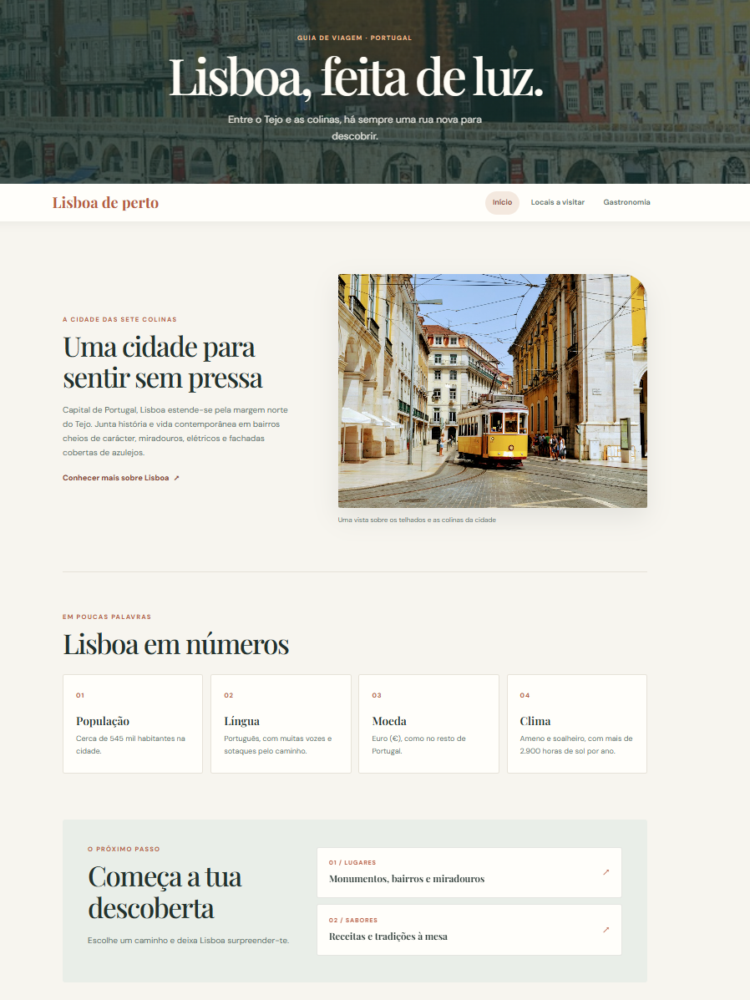

# Lisboa de perto (Versão Dinâmica)

Uma aplicação web dinâmica que serve como guia turístico e gastronómico para descobrir Lisboa. O projeto evoluiu a partir da versão estática anterior, passando a integrar uma arquitetura backend em Flask com base de dados relacional gerida através do Flask-SQLAlchemy, permitindo apresentar os monumentos, bairros e tradições culinárias da cidade de forma modular e dinâmica.

## Pré-visualização: <small>*O projeto encontra-se publicado e funcional na Vercel*</small>
🔗 [Visitar Lisboa de Perto]([https://lisboa-de-perto.vercel.app](https://lisboa-de-perto-app.vercel.app))




## Conteúdos

### Início

A rota principal (`/`) apresenta a página de entrada definida em [`app/templates/index.html`](./app/templates/index.html), oferecendo uma introdução à cidade de Lisboa, factos históricos e atalhos rápidos de navegação para os locais a visitar e para o guia gastronómico.

### Locais a visitar

Acedida através da rota `/locais`, a página [`app/templates/locais.html`](./app/templates/locais.html) apresenta os pontos emblemáticos da capital registados na base de dados:

- **Torre de Belém** — monumento manuelino classificado junto às margens do Tejo;
- **Castelo de São Jorge** — fortificação histórica com vista panorâmica sobre a cidade;
- **Alfama** — bairro antigo e tradicional, caracterizado pelas ruas estreitas e pelo Fado.

### Gastronomia

Na rota `/gastronomia`, o template [`app/templates/gastronomia.html`](./app/templates/gastronomia.html) dá a conhecer os sabores típicos alfacinhas, destacando especialidades como o pastel de nata, o bacalhau à Brás e as sardinhas assadas. A secção mantém uma tabela detalhada com recomendações por bairro e um leitor multimédia incorporado para a demonstração de receitas.

## Organização do projeto

```text
.
├── app/
│   ├── __init__.py           # Fábrica da aplicação Flask e instância da base de dados
│   ├── models.py             # Modelos de dados SQLAlchemy (Locais e Gastronomia)
│   ├── routes.py             # Definição de endpoints e renderização de vistas
│   ├── static/
│   │   └── css/
│   │       ├── style.css         # Estilos globais e componentes comuns
│   │       ├── locais.css        # Folha de estilo dedicada à página de locais
│   │       └── gastronomia.css   # Folha de estilo dedicada à gastronomia
│   └── templates/
│       ├── index.html        # Estrutura base da página inicial
│       ├── locais.html       # Vista dos pontos turísticos
│       └── gastronomia.html  # Vista do roteiro gastronómico
├── requirements.txt          # Pacotes e versões necessárias para o ambiente Python
├── run.py                    # Script de inicialização do servidor local
├── .gitignore                # Regras de exclusão de ficheiros locais e temporários
└── README.md                 # Documentação do repositório
```

A estrutura do projeto adota o padrão de organização modular em Flask. Todo o núcleo da aplicação reside no diretório [`app/`](./app/), onde a camada de apresentação (`templates/` e `static/css/`) se encontra separada da lógica de controlo (`routes.py`) e das tabelas da base de dados (`models.py`).

## Design e funcionalidades

- Aplicação web com geração de páginas dinâmicas no servidor através de rotas Flask.
- Gestão e persistência de dados estruturados com recurso ao ORM Flask-SQLAlchemy e SQLite.
- Layout adaptável a computadores, tablets e telemóveis.
- Navegação fluida e consistente entre as três páginas do guia.
- Cartões interativos, fotografias informativas e tabelas organizadas por zona.
- Transições suaves e efeitos visuais ao passar o cursor sobre os elementos interativos.
- Acessibilidade garantida com descrições textuais alternativas nas imagens e respeito pela preferência por movimento reduzido.

## Como executar

Ao contrário da versão estática inicial, esta aplicação necessita de um interpretador Python e das dependências listadas instaladas no sistema.

1. Descarrega ou clona este repositório:
   ```bash
   git clone https://github.com/jm47okjk/SI-trabalho-2.git
   cd SI-trabalho-2
   ```

2. Cria e ativa um ambiente virtual:
   - **No Windows:**
     ```powershell
     python -m venv venv
     .\venv\Scripts\Activate.ps1
     ```
   - **No Linux/macOS:**
     ```bash
     python3 -m venv venv
     source venv/bin/activate
     ```

3. Instala os módulos necessários:
   ```bash
   pip install -r requirements.txt
   ```

4. Inicia a aplicação:
   ```bash
   python run.py
   ```

5. Abre o navegador e acede ao endereço local:
   ```text
   http://127.0.0.1:5000/
   ```

## Recursos externos

As fotografias, os tipos de letra e os conteúdos de vídeo são carregados através de serviços online. É necessária uma ligação ativa à Internet para a sua correta visualização. Se a incorporação do vídeo não carregar devido a políticas de rede, a secção de gastronomia mantém uma ligação direta para o YouTube.

## Tecnologias

<p align="left">
  
  
  
  
  
  
  
  
</p>
